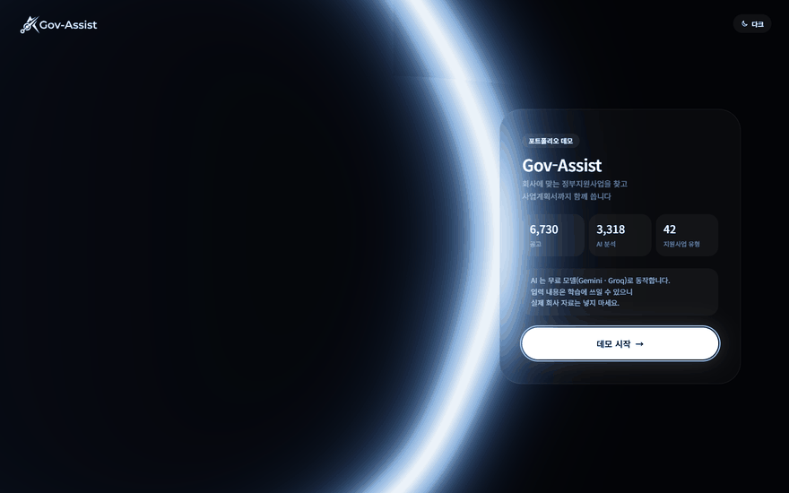
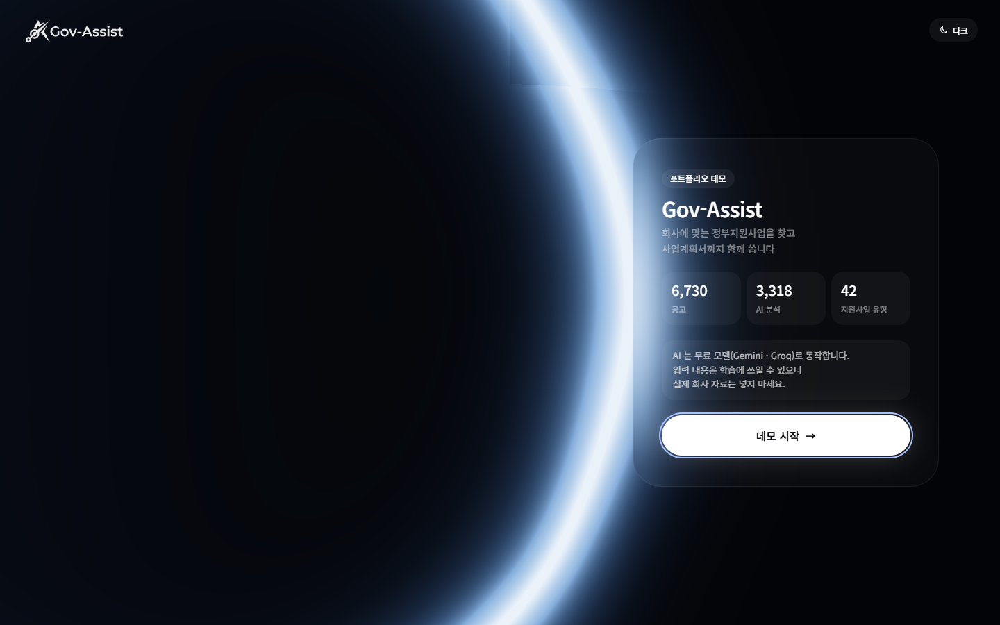
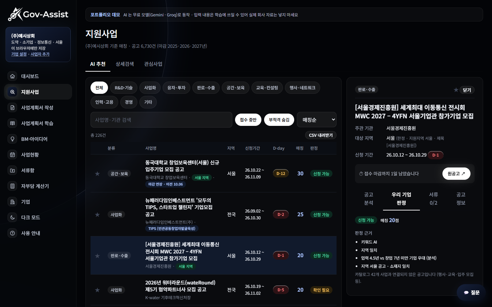
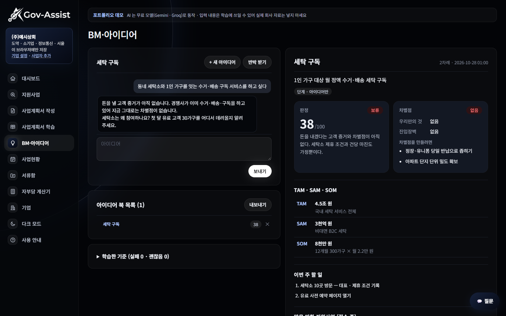
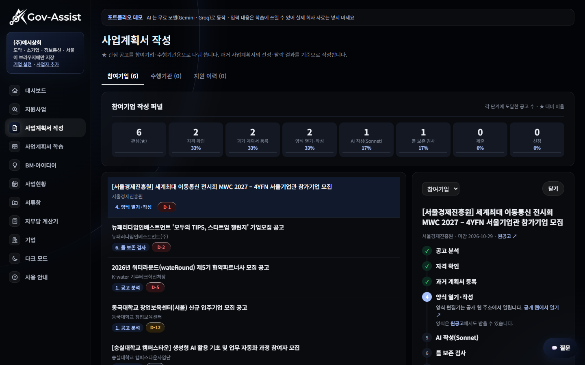
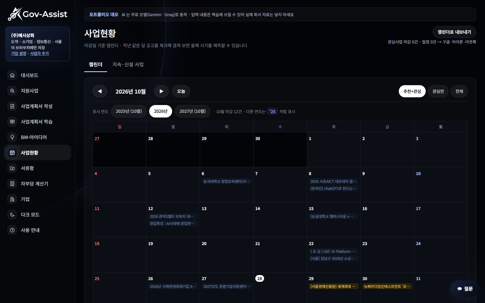
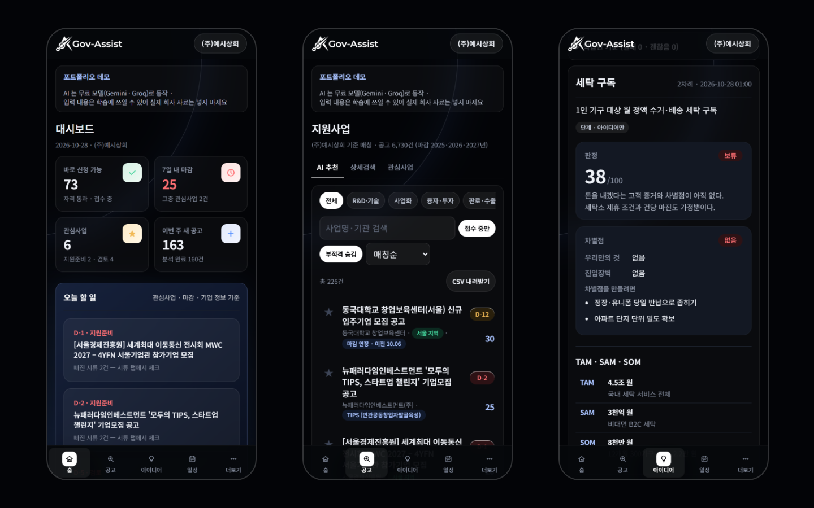
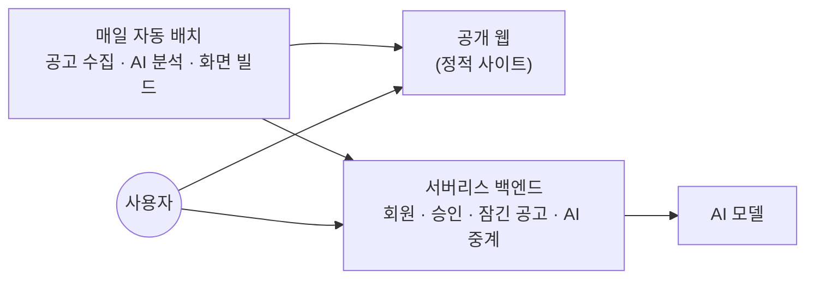

# Gov-Assist — 정부지원사업 매칭·사업계획서 작성 보조

> 회사 정보 5가지만 넣으면 **6,700여 건의 정부지원사업 공고**를 그 회사 기준으로 걸러 주고, 마감 관리부터 **사업계획서 작성·BM 검증까지 AI로 돕는** 웹 서비스입니다.

**🔗 데모:** https://demo.govassist.co.kr

데모의 AI는 무료 모델로 돌아갑니다. 실제 회사 자료는 넣지 마세요.

---

## 주요 기능

| | |
| --- | --- |
|  | **초기 화면 · 회원 인증** 회원가입 후 관리자 승인을 받으면 전체 공고와 AI 기능이 열립니다. 로그인에 실패하면 화면의 빛 링이 빨갛게 바뀝니다. |
|  | **지원사업 매칭** 업력·업종·지역·대표 연령·매출 등으로 공고마다 신청 가능 여부를 판정하고 근거를 보여 줍니다. |
|  | **BM·아이디어 북** 대화하듯 아이디어를 적으면 AI가 판정·차별점·시장 규모·마일스톤·이번 주 할 일을 정리해 쌓습니다. |
|  | **사업계획서 작성** 공고 양식(HWP/HWPX)을 브라우저에서 열고 AI와 함께 칸을 채웁니다. 과거 선정 계획서의 틀을 참고합니다. |
|  | **사업현황 · 캘린더** 관심 공고의 마감과 일정을 한눈에 보고 캘린더로 내보냅니다. |
|  | **휴대폰 앱(PWA)** 홈 화면에 설치해 앱처럼 씁니다. |

> 화면의 회사(`(주)예시상회`)와 아이디어 북 내용은 캡처용 예시 데이터입니다.

---

## 구조

- 공고 수집·분석·화면 빌드는 매일 자동으로 돌고, 화면은 정적 사이트로 배포됩니다.
- 회원 관리처럼 서버가 꼭 필요한 부분만 서버리스 백엔드가 맡습니다.
- 사업자 정보와 아이디어 기록은 사용자 브라우저에만 저장됩니다.

---

## 기술 스택

| 영역 | 사용 기술 |
| --- | --- |
| 화면 | JavaScript · CSS · WebGL · PWA |
| 데이터·배치 | Python · GitHub Actions |
| AI | Claude · Gemini · Groq · OpenRouter |
| 서버 | Cloudflare Workers |
| 배포 | GitHub Pages · Cloudflare |

---

## 직접 해결한 문제

**1. 서버 없는 정적 사이트에 회원 잠금 넣기**
정적 사이트는 화면에서 잠가도 소스를 열면 내용이 보입니다. 공개 파일과 회원 전용 데이터를 나누고, 승인된 회원에게만 전달되게 바꿔 실제로 잠기게 했습니다.

**2. 유료 AI 없이 같은 기능을 무료 모델로**
포트폴리오 데모는 유료 AI 대신 무료 모델로 동작합니다. 앱 코드를 다시 짜지 않고, 중간에서 요청 형식을 맞춰 주는 방식으로 전 기능이 돌게 했습니다.

**3. 불안정한 무료 모델 대응 — 응답 2분 → 3초**
무료 모델은 몰리거나 막히는 일이 잦습니다. 응답이 늦거나 실패한 모델을 자동으로 피해 다음 모델로 넘어가게 해, 같은 요청을 몇 초 안에 끝내게 했습니다.

**4. 수천 건 공고 매칭을 브라우저에서 바로**
기업 정보를 바꿀 때마다 서버를 거치지 않고 브라우저에서 즉시 다시 계산합니다. 여러 사업자를 등록하면 더 잘 맞는 쪽도 알려 줍니다.

**5. 화면 품질을 자동으로 점검**
다크 테마를 넣은 뒤 일부 화면에 글씨가 안 보이는 곳이 생겼습니다. 모든 화면과 PC·휴대폰 크기를 자동으로 훑어 대비가 부족한 곳을 찾는 점검을 만들어, 사람이 놓친 오류까지 잡았습니다.

---

이 저장소는 프로젝트 소개용입니다. 서비스 소스 코드는 공개하지 않습니다.
